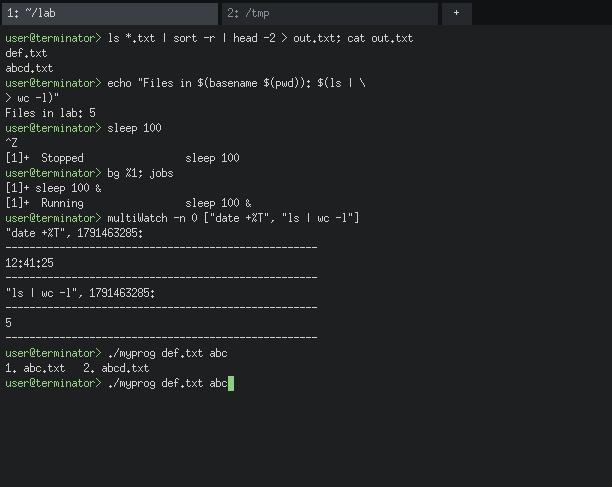

# Terminator

A terminal and a shell in one program, written in C on top of X11 and Linux
system calls. Terminator draws its own window with tabs, reads keys as X11
events, and runs commands with `fork`, `execvp`, `pipe`, `dup2` and `waitpid`.
Signals and job control work without a TTY: the shell sends them itself.



## Dependencies

- Linux (uses `pipe2`, `close_range`, `/proc`-free fd handling)
- `gcc`, `make`
- Xlib headers and library: `sudo apt install libx11-dev` (Debian/Ubuntu)
  or `sudo dnf install libX11-devel` (Fedora)
- An X server (any Linux desktop, WSLg, or `Xvfb` for testing)

## Build and run

```sh
make                          # builds ./terminator
./terminator                  # thread mode (default): each tab is a thread
./terminator useProcess=True  # process mode: each tab is a forked process
make test                     # 29 engine tests, no window needed
```

Without a window (handy for testing the shell engine on its own):

```sh
./terminator -c 'ls | wc -l'        # run one command line
./terminator script.sh arg1 arg2    # interpret a script
./terminator --headless < cmds.txt  # read commands from stdin
```

## Features

| # | Feature | What works |
|---|---|---|
| 01 | X11 GUI and tabs | Own window, tab bar, `+` button, `Ctrl+Shift+T` new tab, `Ctrl+Shift+W` close, `Ctrl+PgUp/PgDn` switch, click to switch. Hidden tabs keep collecting output. Scrollback of 10,000 lines (mouse wheel, `Shift+PgUp/PgDn`). Resizable. |
| 02 | Commands | External commands via `fork` + `execvp` + `waitpid`. Builtins: `cd` (incl. `cd -`, `cd` → home), `pwd`, `exit [n]`, `export`, `unset`, `shift`, `help`, `clear`. `$?` holds the last status; 127 for unknown commands. |
| 03 | Multiline input | Open `'` or `"`, a trailing `\`, an unclosed `$(`, a trailing `\|`, `&&` or an unfinished `if` all show `> ` and keep reading. `'single'` is literal, `"double"` expands `$VAR` and `$(...)`. `$(...)` nests, innermost first. Also `~`, globbing (`*.txt`), `$VAR`, `${VAR}`, `$?`, `$#`, `$1..$9`, `$@`, `$$`. |
| 04 | Redirection | `<`, `>`, `>>`, `2>`, `2>>`, `2>&1`, on external commands and builtins. A missing input file is reported and the command does not run. |
| 05 | Pipes | Any number of stages: `ls *.txt \| sort \| head -5`. Combined with redirection. Builtins work inside pipelines. Also `&&`, `\|\|`, `;`. |
| 06 | multiWatch | `multiWatch ["cmd1", "cmd2"]` runs the commands in parallel (each in its own process group) and prints every chunk of output as it arrives, in the required format. Re-runs each command every 2 s like `watch`; `multiWatch -n 5 [...]` changes the interval, `-n 0` runs once. `Ctrl+C` kills every child; the tab keeps working. |
| 07 | Hotkeys | Bash defaults (table below). Change them in `~/.terminatorrc` or with the `bind` builtin at run time (saved to the rc file, so they survive a restart). Bad bindings print a warning and keep the default. `bind -l` lists everything. |
| 08 | Signals and jobs | `Ctrl+C` → `SIGINT`, `Ctrl+Z` → `SIGTSTP` to the foreground job's process group only. `cmd &`, `jobs`, `fg %n`, `bg %n`. Finished background jobs are reported before the next prompt. Typed lines go to the foreground job's stdin (try `cat`), `Ctrl+D` sends EOF. |
| 09 | History | 10,000 entries in `~/.terminator_history`, survives restarts. `history [n]` shows the last 1,000 (or n). Shared by every tab in both modes: type in tab 1, press `↑` in tab 2. `Ctrl+R` → `Enter search term:` → exact match, else longest-common-substring matches (> 2 chars), else `No match for search term in history`. An exact match is also placed on the input line. |
| 10 | Auto-complete | `Tab` completes file names (not commands): one match completes it, several extend to the longest common prefix and show a numbered list (press the number), none does nothing. Directories get a trailing `/`. Works in subdirectories and with `~/`. |
| 11 | Scripts | `./run.sh`, `bash run.sh`, `sh run.sh`, `source run.sh` / `. run.sh` are all interpreted by Terminator itself (never handed to `/bin/bash`). Variables, `$1..$9`, `$#`, `$?`, nested `if/elif/else` with `[ ]` tests, pipes, redirection, `$(...)`, `exit n`. |
| — | Two modes | Thread mode and process mode behave the same; see DESIGN.md. In process mode a crashing tab cannot take the window down. |
| — | Clipboard | Drag with the mouse to select, `Ctrl+Shift+C` copies (the input line if nothing is selected), `Ctrl+Shift+V` or middle-click pastes. Uses the X `CLIPBOARD`, so it works with other apps and between tabs. |

### Default keys

| Action (`bind` name) | Default |
|---|---|
| move-left / move-right | `←` / `→` |
| line-start / line-end | `Ctrl+A`, `Home` / `Ctrl+E`, `End` |
| history-prev / history-next | `↑` / `↓` |
| delete-to-start / delete-to-end | `Ctrl+U` / `Ctrl+K` |
| delete-word | `Ctrl+W` |
| clear-screen | `Ctrl+L` |
| eof (close tab / send EOF) | `Ctrl+D` |
| copy / paste | `Ctrl+Shift+C` / `Ctrl+Shift+V` |
| interrupt / suspend | `Ctrl+C` / `Ctrl+Z` |
| history-search | `Ctrl+R` |
| complete | `Tab` |
| new-tab / close-tab | `Ctrl+Shift+T` / `Ctrl+Shift+W` |
| next-tab / prev-tab | `Ctrl+Page_Down` / `Ctrl+Page_Up` |
| scroll-up / scroll-down | `Shift+Page_Up` / `Shift+Page_Down` |
| backspace / delete-char / accept-line | `BackSpace` / `Delete` / `Return` |

Rebinding, in `~/.terminatorrc` (see `examples/terminatorrc`) or at the prompt:

```
bind clear-screen Ctrl+Shift+L
bind delete-word Alt+Backspace
```

Key names: a letter, or `Backspace`, `Enter`, `Tab`, `Esc`, `Up`, `Down`, `Left`,
`Right`, `Home`, `End`, `PageUp`, `PageDown`, `Delete`, `Space`, `F1`..`F12`,
with any of `Ctrl+`, `Shift+`, `Alt+`. Giving a key to a new action removes it
from the old one.

## Demo commands

`examples/DEMO.md` walks through every feature in order with commands to type.
`examples/check.sh` is the script from the project slides.

## Known limitations

- Not implemented (not required): loops, functions, arithmetic `$(( ))`,
  backticks, here-documents, `case`, aliases, command completion.
- Commands write into a pipe, not a terminal, so full-screen programs
  (`vim`, `top`, `less`) do not work, and `ls` prints one name per line.
  ANSI colour codes are stripped.
- The window uses X core fonts (Latin-1). Non-ASCII UTF-8 text is shown as `?`.
- Lines typed while a foreground job runs go to that job's stdin, so
  type-ahead meant for the shell is consumed by the job (like a pipe, unlike a TTY).
- Ctrl+C does not interrupt a slow `$(...)` inside an assignment
  (`x=$(sleep 10)`), because the shell itself is waiting for it.
- `$$` is the tab's process in process mode and the Terminator process in
  thread mode (tabs share one process there).

## Layout

```
src/main.c       entry point, mode selection
src/gui.c/.h     X11 window, event loop, tabs, line editing, Ctrl+R, completion, clipboard
src/keys.c/.h    hotkey table, ~/.terminatorrc, bind
src/shell.c/.h   shell engine: expansion, exec, pipes, redirection, builtins, jobs, scripts, multiWatch
src/parse.c/.h   lexer and parser (detects incomplete input for multiline)
src/history.c/.h shared history in MAP_SHARED memory with a pshared semaphore
src/proto.c/.h   framed messages between the GUI and each tab's shell
tests/           run_tests.sh (engine tests), xtype.c (sends keys to the window for GUI tests)
examples/        DEMO.md, check.sh, terminatorrc
DESIGN.md        design document
```
